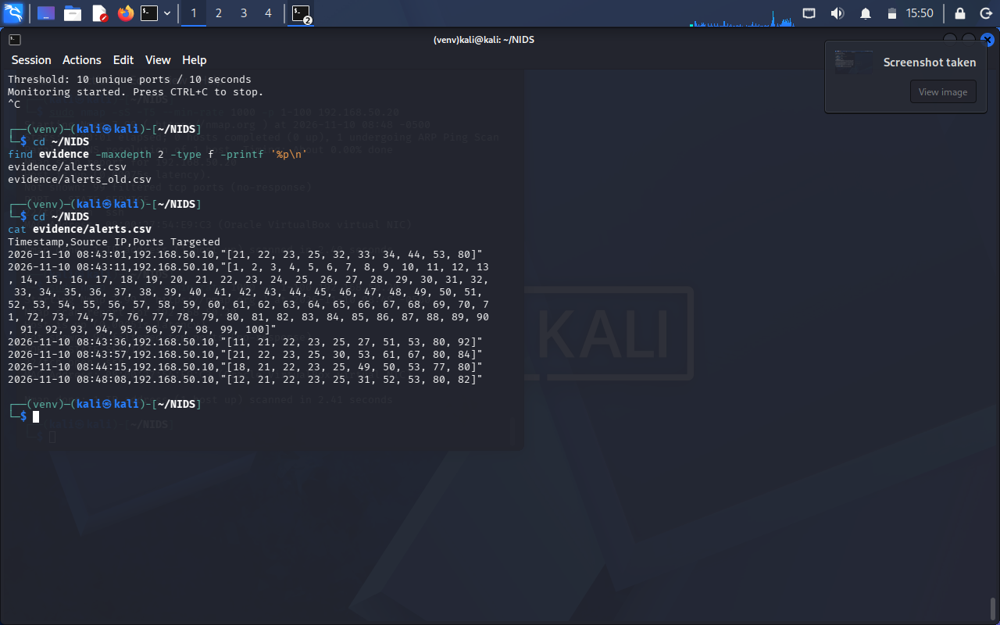

# Network Intrusion Detection System (NIDS)

A lightweight, Python-based Network Intrusion Detection System that monitors TCP traffic and detects potential SYN port scans using Scapy.

## Features

- Captures live network traffic using Scapy.
- Identifies TCP SYN packets without the ACK flag.
- Tracks unique destination ports contacted by each source IP.
- Detects potential port scans using a configurable threshold and time window.
- Displays alerts in the terminal.
- Saves detected alerts to a CSV file.
- Includes an alert cooldown to reduce repeated alerts.

## How It Works

The detector monitors TCP SYN packets. When a source IP contacts 10 or more unique destination ports within 10 seconds, the system generates an alert.

The alert includes the timestamp, source IP address, and destination ports.

## Project Structure

```text
NIDS/
├── README.md
├── requirements.txt
├── .gitignore
├── src/
│   └── detector.py
├── docs/
│   ├── architecture.md
│   └── testing.md
└── evidence/
    ├── alerts.csv
    └── screenshots/
        └── nids-csv-logs.png.png
```

## Requirements

- Python 3
- Scapy
- Linux environment
- Root privileges for packet capture

## Installation

Clone the repository:

```bash
git clone https://github.com/robinea/-Network-Intrusion-Detection-System.git
cd -- -Network-Intrusion-Detection-System
```

Create and activate a virtual environment:

```bash
python3 -m venv venv
source venv/bin/activate
```

Install dependencies:

```bash
pip install -r requirements.txt
```

## Configuration

The detection settings are defined in `src/detector.py`:

```python
THRESHOLD = 10
TIME_WINDOW = 10
ALERT_COOLDOWN = 10
INTERFACE = "eth1"
```

- `THRESHOLD`: Number of unique destination ports required to trigger an alert.
- `TIME_WINDOW`: Time period, in seconds, for tracking port connections.
- `ALERT_COOLDOWN`: Minimum time, in seconds, between repeated alerts.
- `INTERFACE`: Network interface monitored by the detector.

Change the interface to match your network setup.

## Running the Detector

Run the following command from the project directory:

```bash
sudo ./venv/bin/python src/detector.py
```

## Testing

The system was tested in an isolated VirtualBox network using two virtual machines:

- Kali Linux: `192.168.50.10`
- Ubuntu Server: `192.168.50.20`

An Nmap SYN scan was performed from Kali Linux against the Ubuntu Server:

```bash
sudo nmap -sS -p 1-100 192.168.50.20
```

The detector successfully identified the scan and generated an alert. The alert was also saved to the CSV log file.

See [Testing Documentation](docs/testing.md) for more details.

## Evidence

The screenshot below shows detected alerts saved in the CSV log file.



## Documentation

- [System Architecture](docs/architecture.md)
- [Testing Documentation](docs/testing.md)

## Limitations

- Detects potential TCP SYN port scans only.
- Uses a threshold-based detection method, so false positives are possible.
- Monitors IPv4 TCP traffic.
- Does not inspect packet payloads or detect other types of attacks.
- Requires the correct network interface to be configured.

## Disclaimer

This project was developed for educational purposes and tested in an isolated virtual lab. Use it only on networks you own or have explicit permission to monitor and test.
